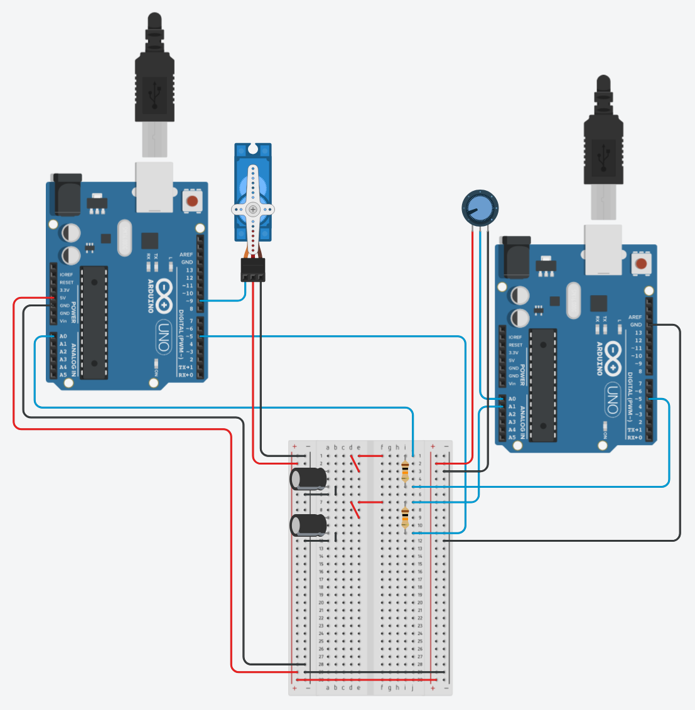

# Heavy Machinery Control Simulation (v2 — Dual-Arduino HIL)

A true **Hardware-in-the-Loop (HIL)** simulation built across **two Arduino Uno** boards that models the rotational physics and closed-loop PID control of heavy machinery (such as a turret, radar dish, or aircraft yaw axis).

- **Arduino 1 (Controller / Pilot):** Reads the operator's target heading from a rotary potentiometer, receives real-time angle feedback from the plant, and computes PID actuator commands.
- **Arduino 2 (Heavy Machinery / Plant):** Receives raw motor power commands over hardware PWM, integrates rotational inertia, drag, and hard stops at 50 Hz, drives a visual servo gauge, and sends heading feedback back to the controller.

## What's New in v2
- **True Dual-Board HIL Split:** Separated `computeController()` and `simulatePlant()` onto two independent microcontrollers communicating via real physical electrical signals rather than shared memory.
- **Analog PWM + RC Low-Pass Filtering:** Uses 980 Hz PWM (`Pin D5`) paired with hardware RC low-pass filters (`10 kΩ` + `10 µF`) to transmit smooth bidirectional analog control and sensor signals between boards.
- **Improved PID Stability:** Added conditional integral anti-windup (`±15°` active zone) and tuned PID gains (`Kp = 2.0`, `Ki = 0.2`, `Kd = 3.0`) to eliminate overshoot on high-inertia loads.

## Features
- **Decoupled HIL Architecture:** Allows testing and tuning controller firmware safely against a simulated physical plant before deploying to real hardware.
- **Physics-Based Plant Model:** Simulates rotational inertia, bearing/air drag, torque limits, and mechanical hard stops (`-135°` to `+135°`).
- **50 Hz Fixed-Step Control & Physics Loops:** Both boards run synchronized `dt = 0.02s` loops for deterministic integration and derivative calculation.
- **Real-Time Serial Plotter Telemetry:** Outputs `Target`, `Control`, and `Angle` values formatted for live graphing.

## Hardware & Wiring

### Components
- 2× Arduino Uno
- 1× Rotary Potentiometer (270° sweep)
- 1× Micro Servo Motor
- 2× `10 kΩ` Resistors (RC low-pass filters)
- 2× `10 µF` Capacitors (RC low-pass filters)
- 1× Breadboard & Jumper Wires

### Pin Connections

#### Shared Ground

| Connection | From | To | Notes |
| :--- | :--- | :--- | :--- |
| **Common Ground** | Arduino 1 `GND` | Arduino 2 `GND` | Required reference bridge for inter-board signals |

#### Arduino 1 — Controller / Pilot

| Component / Signal | Pin / Node | Arduino 1 Pin | Notes |
| :--- | :--- | :--- | :--- |
| **Potentiometer** | `Terminal 1` | `GND` | Left limit (`-135°`) |
| **Potentiometer** | `Wiper` | `A0` | Target heading input (`-135°` to `+135°`) |
| **Potentiometer** | `Terminal 2` | `5V` | Right limit (`+135°`) |
| **Control Out** | To RC Filter 1 (`10 kΩ`) | `D5` | 980 Hz PWM control signal (`-100%` to `+100%`) |
| **Feedback In** | From RC Filter 2 node | `A1` | Smoothed heading angle from Plant (`-135°` to `+135°`) |

#### Arduino 2 — Heavy Machinery / Plant

| Component / Signal | Pin / Node | Arduino 2 Pin | Notes |
| :--- | :--- | :--- | :--- |
| **Control In** | From RC Filter 1 node | `A0` | Smoothed motor torque command (`-100%` to `+100%`) |
| **Feedback Out** | To RC Filter 2 (`10 kΩ`) | `D5` | 980 Hz PWM current heading angle |
| **Servo Motor** | `V+` | `5V` | Power rail |
| **Servo Motor** | `PWM` | `D9` | Visual angle indicator (`0°` to `180°`) |
| **Servo Motor** | `GND` | `GND` | Ground rail |

#### RC Low-Pass Filters (2× Identical Stages)
Each inter-board PWM line passes through a `1.6 Hz` low-pass filter (`10 kΩ` series resistor + `10 µF` shunt capacitor to `GND`) to convert the 980 Hz square wave into a steady analog DC voltage before `analogRead()`.

## Design


## Video
<!-- Replace with your v2 demo video link -->
<video src="YOUR_V2_VIDEO_URL_HERE" controls="controls" style="max-width: 730px;"></video>

## How It Works

1. **Pilot Target Input (Arduino 1):** Reads the potentiometer on `A0` (`0–1023`) and maps it across the 270° range (`-135°` to `+135°`).
2. **Feedback Sensing (Arduino 1):** Reads the filtered analog voltage on `A1` sent by the Plant Arduino to determine the machinery's current `measuredAngle`.
3. **PID Control Law (`computeController`):** Calculates heading error and outputs a normalized actuator command (`-100%` to `+100%`) as a `0–255` PWM duty cycle on `D5`, using integral anti-windup within `±15°` of the target.
4. **Plant Physics Integration (`simulatePlant` on Arduino 2):** Reads the smoothed control voltage on `A0`, converts it into motor torque, subtracts rotational drag, and integrates angular acceleration over `dt = 0.02s` to update `speed` and `angle` within `[-135°, +135°]`.
5. **Actuation & Return Telemetry (Arduino 2):** Updates the servo position on `D9` and outputs the new heading angle on `D5` back through the second RC filter to Arduino 1, while Arduino 1 prints telemetry for the Serial Plotter:
   ```text
   45.00,62.50,28.40
   ```

## Tunable Parameters

### Controller (`Arduino 1`)
```cpp
// PID Gains (Tuned for high-inertia response)
float Kp = 2.0;   // Proportional turning force
float Ki = 0.2;   // Integral steady-state correction (active within ±15°)
float Kd = 3.0;   // Derivative braking/damping
```

### Heavy Machinery Plant (`Arduino 2`)
```cpp
// Heavy Machinery Physics
float maxMotorTorque = 150.0; // Max torque at 100% control signal
float inertia = 5.0;          // Mass resistance to turning (higher = heavier)
float friction = 0.8;         // Rotational bearing/air drag
```

## Future Improvements
- Upgrade the RC filters to **2-stage (second-order) low-pass filters** or switch to **digital UART/I2C/CAN communication** to eliminate 8-bit PWM quantization stair-stepping on the derivative term.
- Add simulated external disturbances (e.g., wind gusts or variable payload mass) on the Plant Arduino to stress-test controller disturbance rejection.
- Replace the 180° servo with a stepper motor for a 1:1 270° visual sweep.

## Acknowledgements
Special thanks to [Tinkercad Circuits](https://tinkercad.com) and [Wokwi](https://wokwi.com) for providing the circuit simulation tools used to design, test, and iterate on this project.
